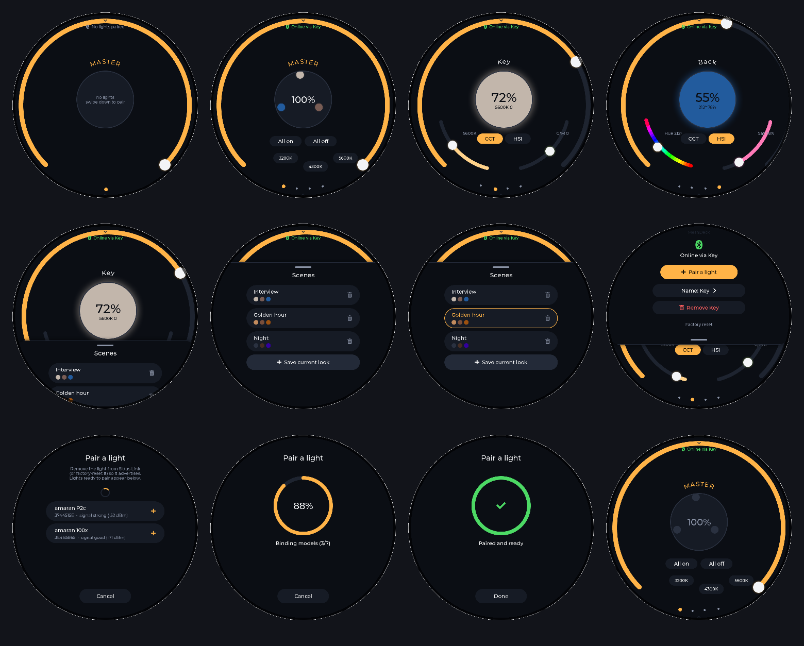

# MeshDeck

A standalone touchscreen controller for Aputure / amaran lights that speak
Sidus Bluetooth mesh — no phone, no Sidus Link Pro, no amaran Desktop.

Hardware: **Waveshare ESP32-P4-WIFI6-Touch-LCD-4C** (ESP32-P4 + ESP32-C6
radio co-processor, 4-inch 720×720 round touch display).

Phase 1: pair a light from the touchscreen, control power, intensity,
CCT / green-magenta and HSI colour, and show a live preview of what the
light is doing.  Phase 2 (front end, done ahead of hardware testing): the
round lighting desk — a swipeable channel carousel with a grand master,
ring faders on the rim, and a scenes drawer with save / recall.  See
`docs/UI_DESIGN.md` and the renders in `docs/ui/`.



## How it works

The Sidus lights are ordinary Bluetooth SIG Mesh nodes (Telink SIG-mesh
firmware) with one proprietary access opcode, `0x26`, that carries the
10-byte light-control payloads reverse-engineered by the community.
MeshDeck does what the Sidus phone app does:

```
touchscreen (LVGL)  ->  app_core (state machine, one task)
                          |-- mesh_prov   PB-GATT provisioner (ECDH P-256, no-OOB)
                          |-- mesh_cfg    config client: composition, AppKey Add, Model App Bind
                          |-- mesh_net    network/transport layers, segmentation, proxy config
                          |-- telink      0x26 payload encode / status decode
                          `-- ble_central NimBLE central, GATT proxy client, SAR
                                   |
                        ESP-Hosted (HCI over SDIO)
                                   |
                     ESP32-C6 Bluetooth controller  ~~~ BLE ~~~  light (proxy)  ~~ mesh ~~  other lights
```

* MeshDeck **creates its own mesh network** (random NetKey / AppKey) and is
  the provisioner at unicast address `0x0001`.  That is also where the lights
  send their status reports, so state read-back works without any patched
  stack.
* Pairing = standard mesh provisioning over PB-GATT, then AppKey Add and a
  bind of the AppKey to every model in the light's composition data (the same
  "default key bind" the Sidus app performs).
* Control = `0x26` messages sent through whichever paired light MeshDeck is
  connected to as a GATT proxy; the mesh relays them to the others.

The protocol layers (`mesh_crypto`, `mesh_net`, `mesh_prov`, `mesh_cfg`,
`telink`) are plain C with no ESP-IDF dependencies and are covered by host
unit tests against Bluetooth SIG sample data and real captured amaran values.

## Repository layout

```
main/
  app_core.[ch]     link + pairing state machine, command queue, status polling
  ble_central.[ch]  NimBLE scanning/connection, GATT proxy/provisioning chars, SAR
  mesh_crypto.[ch]  AES-CMAC, AES-CCM, s1/k1..k4, ECDH (mbedTLS on target)
  mesh_net.[ch]     network PDU crypto, segmentation/reassembly, proxy config, beacons
  mesh_prov.[ch]    provisioner state machine
  mesh_cfg.[ch]     configuration client messages
  telink.[ch]       Telink/Sidus 0x26 payloads
  lights.[ch]       light registry + preview colour
  store.[ch]        NVS persistence
  board.[ch]        display (JD9365 over MIPI-DSI), touch (GT911), backlight, LVGL port
  ui/               LVGL screens: home, pair, control
components/
  lvgl/             git submodule, v9.3.0
  esp_hosted/       git submodule, esp-hosted-mcu v2.12.13 (P4 <-> C6 transport + HCI)
  esp-wifi-remote/  git submodule, wifi_remote v0.14.5 (required by esp_hosted; Phase 3 Wi-Fi)
  esp_lvgl_port/    vendored from espressif/esp-bsp
  esp_lcd_touch*/   vendored from espressif/esp-bsp
  esp_lcd_jd9365/   vendored from espressif/esp-iot-solution
tests/host/         host unit tests (gcc + OpenSSL)
tools/sim/          headless LVGL renderer: screenshots of every screen without hardware
docs/               research notes, protocol summary, hardware test plan
```

## Building

Requirements: ESP-IDF **v5.5.x** (the board vendor's supported line; v5.5.5
was used here), Python 3, git.  The IDF Component Manager is disabled by the
project — every dependency is in-tree.

```bash
git clone --recursive <this repo> meshdeck
cd meshdeck
. ~/esp/esp-idf/export.sh
idf.py set-target esp32p4
idf.py build
idf.py -p /dev/cu.usbmodem* flash monitor      # USB-C "UART" port of the board
```

Host tests and UI renders (no hardware needed):

```bash
cd tests/host && make test               # protocol unit tests
cd tools/sim && make && ./render && python3 to_png.py   # writes out/*.png + contact sheets
```

## Before the first flash: the ESP32-C6 co-processor

The P4 has no radio.  Bluetooth comes from the on-board ESP32-C6 running the
**ESP-Hosted slave** firmware, connected over SDIO (P4 GPIO14–19, reset on
GPIO54 — the ESP-Hosted defaults for the P4, confirmed against the Waveshare
schematic).  Waveshare ships the C6 with an ESP-Hosted image, but the vendor
does not document whether its Bluetooth controller is enabled.

On boot MeshDeck logs the transport capabilities it negotiates with the C6.
Look for a line like `transport: - HCI over SDIO` (or `BT` in the capability
list).  If the log instead says the BT controller failed to initialise, flash
the C6 with the ESP-Hosted slave firmware for `esp32c6` (its default config
enables BLE over SDIO):

```bash
cd components/esp_hosted/slave
idf.py set-target esp32c6
idf.py build
# connect a USB-UART adapter to the board's "ESP32-C6 UART" header, hold the
# C6 in download mode, then:
idf.py -p <c6-port> flash
```

(ESP-Hosted also supports updating the slave from the P4 itself; see
`components/esp_hosted/examples/host_performs_slave_ota`.)

## Pairing a light

1. The light must be **unprovisioned**.  A light that is still in a Sidus
   Link / amaran app network will not appear.  Remove it in the app (light
   settings → remove / unbind) or perform the light's factory reset.
2. On MeshDeck tap **+**.  Lights in pairing mode show up within a few seconds
   (name if advertised, first bytes of the device UUID, signal strength).
3. Tap the light.  Progress: connect → provisioning (ECDH) → the light restarts
   → MeshDeck reconnects to it → composition → AppKey → model binding → done.
4. The light appears on the home screen.  Tap it to control it.

Remove a light with the bin icon on its control screen (sends Config Node
Reset so it goes back to pairing mode).

## Status and known unknowns

Everything compiles for the ESP32-P4 and the protocol core passes its host
tests, but **this has not yet run on hardware**.  The first hardware session
should check, in order (see `docs/HARDWARE_TEST_PLAN.md`):

1. Display and touch come up (JD9365 init sequence and GT911 address probe
   copied from the Waveshare BSP v3.0.1).
2. The C6 answers over SDIO and the NimBLE host syncs (`ble: host synced`).
3. An unprovisioned light is seen (`core: unprovisioned device: ...`).
4. Provisioning completes and the light comes back advertising Node Identity.
5. AppKey Add / binds get status responses and a `0x26` status report arrives.

Risks called out in `docs/RESEARCH.md`: the Sidus firmware might require the
Telink "fast provisioning" flow instead of standard PB-GATT (the app supports
both; standard is expected), the exact model that must hold the AppKey is
unknown (we bind all of them), and the C6 factory image may lack Bluetooth.

## Using the desk

* **Swipe left / right** between the Master page and each light.  Drag the
  rim ring for intensity (on Master it is the grand master and scales every
  channel).  Tap the centre disc for power.  CCT / HSI chips switch the lower
  band between colour temperature + green/magenta arcs and a hue wheel +
  saturation arc.
* **Swipe up** for Scenes: tap to recall, long-press to overwrite with the
  current look, bin to delete, "+" to save the current look.
* **Swipe down** for the system sheet: link status, pair a light, rename the
  current light (cycles studio names), remove it, factory reset.

## Roadmap

* **Phase 2 (remaining)** — effects (the opcodes are documented in the
  amaran-hacs project), groups, free-text naming, fade times.
* **Phase 3** — Wi-Fi: join existing infrastructure through the C6
  (`esp_wifi_remote` is already in the tree), remote / web control, optional
  import of an existing Sidus network from an amaran Desktop export instead
  of re-pairing.

## Credits

Protocol reverse engineering by the community — see `docs/PROTOCOL.md`:
[wesbos/amaran-BLE-control](https://github.com/wesbos/amaran-BLE-control),
[kevinschaich/amaran-bridge](https://github.com/kevinschaich/amaran-bridge),
[neyako/amaran-hacs](https://github.com/neyako/amaran-hacs).  Board support
from [waveshareteam](https://github.com/waveshareteam/Waveshare-ESP32-components).
